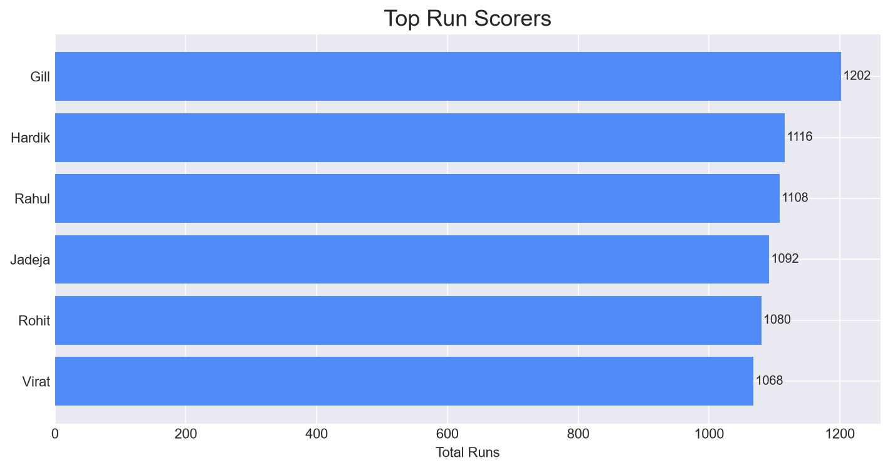
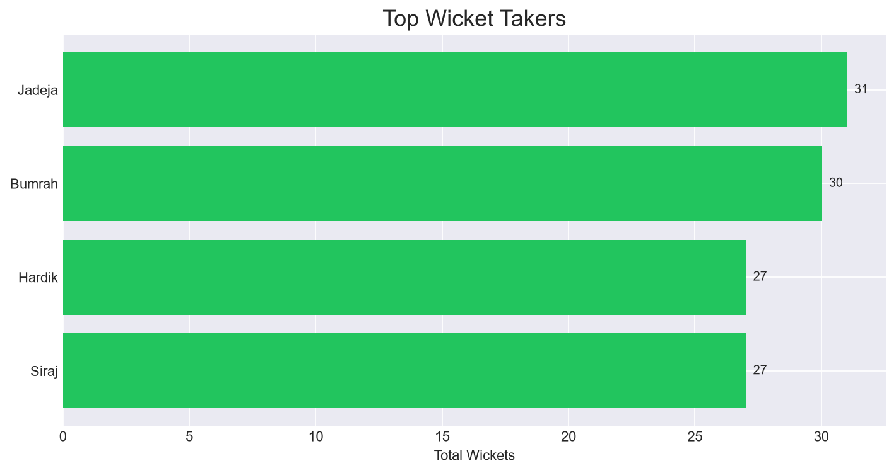
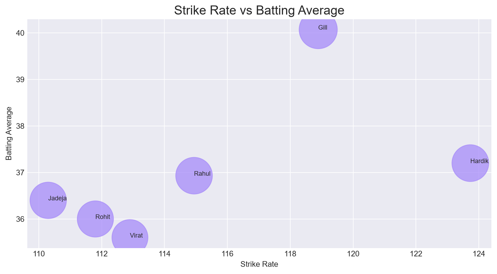

# 🏏 Sports Performance Analytics Dashboard

An interactive dashboard that analyses cricket player performance using Python, Pandas, Plotly and Streamlit.


## 📸 Screenshots




## ✨ Features
- Player-wise runs, wickets, strike rate, batting average and economy
- Opponent and date-range filters
- Player analysis with 5-match rolling average
- Side-by-side player comparison (radar chart)
- Opponent analysis with heatmap
- Dark theme

## 🛠 Tech Stack
Python, Pandas, NumPy, Plotly, Streamlit

## 📁 Project Deliverables
- 📄 [Project Report (PDF)](deliverables/Sports_Performance_Analytics_Dashboard_Report.pdf)
- 📊 [Presentation (PPT)](deliverables/Sports_Performance_Analytics_Dashboard_Presentation.pptx?raw=true)

## 📂 Project Structure
```
sports-performance-dashboard/
├── data/                 # matches.csv
├── deliverables/         # report, presentation, chart images
├── .streamlit/           # theme config
├── generate_data.py      # creates sample data
├── analysis.py           # analysis functions
├── app.py                # Streamlit dashboard
└── requirements.txt
```

## ▶️ How to Run
```bash
git clone https://github.com/yashnikam17/sports-performance-dashboard.git
cd sports-performance-dashboard
pip install -r requirements.txt
python generate_data.py
streamlit run app.py
```

## 🚀 Future Scope
- Upload your own CSV
- Real cricket dataset (Kaggle)
- Download reports from the dashboard
- Live deployment

## 👥 Team
- [Yash Nikam](https://github.com/yashnikam17)
- [Anuj Wavhal](https://github.com/anujwavhal2157)

## 📝 Note
Data used in this project is simulated for demo purposes.


"""py -m streamlit run app.py"""